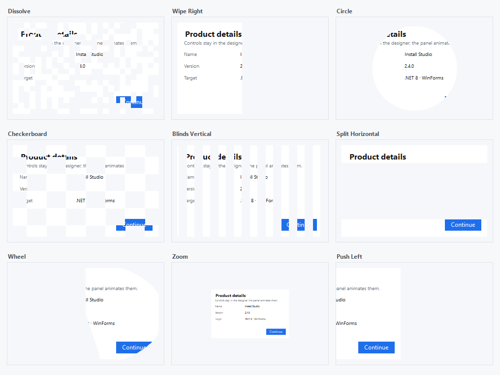
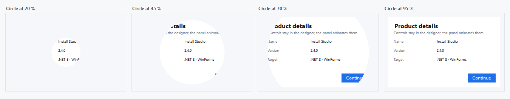
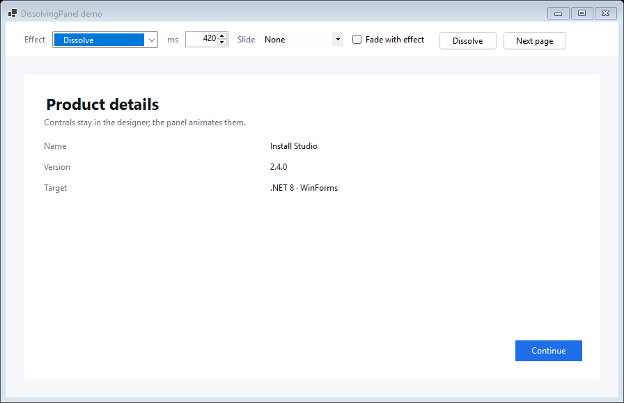

# DissolvingPanel

[](https://www.nuget.org/packages/DissolvingPanel)
[](https://www.nuget.org/packages/DissolvingPanel)
[](https://github.com/DwainSnickles/DissolvingPanel/actions/workflows/ci.yml)
[](LICENSE)
[](https://dotnet.microsoft.com)

A WinForms `Panel` whose contents animate away and come back with PowerPoint-style
transitions. The panel snapshots what it contains, hides the children while the
transition runs (so nothing can be clicked or tabbed to mid-animation), then
reveals the snapshot frame by frame and restores the real controls at the end.

```csharp
var panel = new DissolvingPanel
{
    Dock = DockStyle.Fill,
    Effect = DissolveEffect.WipeRight,
    Duration = 400,
    SlideFrom = SlideDirection.FromBottom,
};

// animate away, then back
panel.DissolveOut();
panel.DissolveIn();
```

## Screenshots

Nine of the built-in effects, each captured mid-transition at 45 %:



`Circle`, frame by frame at 20 %, 45 %, 70 % and 95 %. The panel draws the snapshot
it took on the first frame, so nothing behind it reflows or repaints mid-animation:



The sample app, with every option live:



## Install

```
dotnet add package DissolvingPanel
```

Targets `net8.0-windows` and later, using `UseWindowsForms`.

## Effects

21 transitions, grouped the way the designer and the property grid show them:

| Category | Effects |
| --- | --- |
| **Fades** | `Fade`, `Dissolve` |
| **Wipes** | `WipeLeft`, `WipeRight`, `WipeUp`, `WipeDown`, `SplitHorizontal`, `SplitVertical`, `BlindsHorizontal`, `BlindsVertical` |
| **Pushes** | `PushLeft`, `PushRight`, `PushUp`, `PushDown` |
| **Shape reveals** | `Circle`, `Diamond`, `Box`, `Wheel`, `Zoom`, `Checkerboard`, `RandomBars` |

The grouping lives in `DissolveEffectCatalog` (`Groups`, `Ordered`, `DisplayName`). The
`Effect` property uses it through `DissolveEffectConverter` and `DissolveEffectEditor`,
so the property grid drop-down lists every effect under its category heading in this
order — and so can your own combo boxes, as the sample app shows.

## API

| Member | Purpose |
| --- | --- |
| `Effect` | Transition used in both directions. |
| `Duration` | Length of one transition, in milliseconds. |
| `FadeWithEffect` | Also ramp opacity while the shape effect runs. |
| `SlideFrom` | Slide the whole contents in from an edge while the effect plays. |
| `Easing` | Speed curve: `Linear`, `EaseIn`, `EaseOut` or `EaseInOut` (default). |
| `DissolveOut()` / `DissolveIn()` / `Toggle()` | Run a transition. |
| `PlayIn()` | Reset and animate from dissolved to visible — handy when a tab page appears. |
| `ResetDissolve()` | Stop any running transition and restore the children. |
| `IsAnimating` / `IsDissolved` | Current state. |
| `DissolveCompleted` | Raised when a transition finishes. |
| `RenderFrame(float)` | Render one frame at a fixed progress without animating (previews, docs, tests). |
| `PlayDesignPreview()` | Play the transition once on the design surface, then restore the children. |

Selecting the control in the Visual Studio designer shows a **Dissolve** smart tag
with the effect, duration, easing, slide edge, fade option, a preview command
and a reset command.

**Play preview** (or the "Play dissolve preview" verb on the context menu) runs the
transition once on the design surface.It always puts the surface back: if the panel is hidden, its handle is recreated, or
it is disposed while the preview is running, every child control is restored, so
nothing is left hidden in the designer file.

## Sample app

`samples/DissolvingPanelDemo` is a small WinForms app wired to the control: pick an
effect, a duration, a slide edge and whether to fade, and the card replays straight
away. **Next page** swaps the content and animates the new content in.

```bash
dotnet run --project samples/DissolvingPanelDemo
```

The images above come from that same app running offscreen through `RenderFrame`,
so they can be regenerated without taking a screenshot:

```bash
dotnet run --project samples/DissolvingPanelDemo -- --shots docs
```

## Notes

- `BackColor` defaults to white; set it to match the host surface.
- If the panel is inside a `TabPage`, give the page `Padding = 0` so the panel
  fills it exactly.
- `PlayIn()` is a no-op while the control is invisible or undisposed handles do not
  exist yet, so it is safe to call from a `SelectedIndexChanged` handler.

## Releasing

Version tags publish to nuget.org automatically:

```bash
git tag v1.0.1
git push origin v1.0.1
```

`.github/workflows/release.yml` takes the version from the tag (`v1.0.1` → `1.0.1`), builds,
packs and pushes to nuget.org, so nothing needs bumping by hand. It needs one repository
secret, `NUGET_API_KEY`, created at nuget.org → Account → API keys with the
"Push new packages" scope. Tags such as `v1.1.0-beta.1` publish as pre-releases, and
`--skip-duplicate` makes re-running a tag harmless.

## License

MIT — see [LICENSE](LICENSE).
